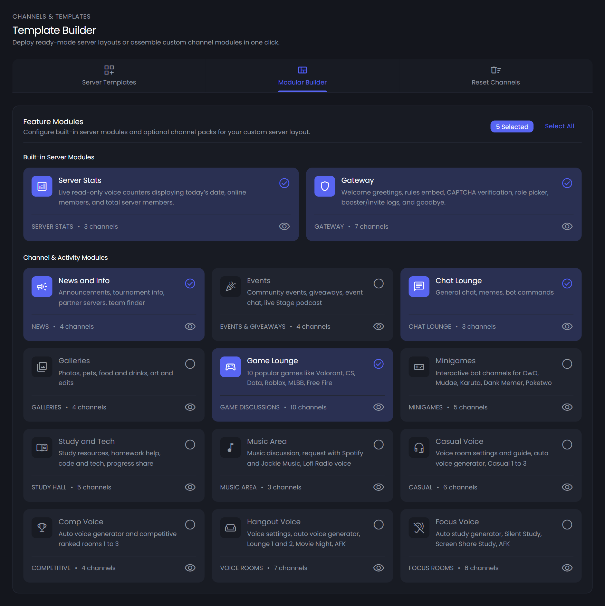
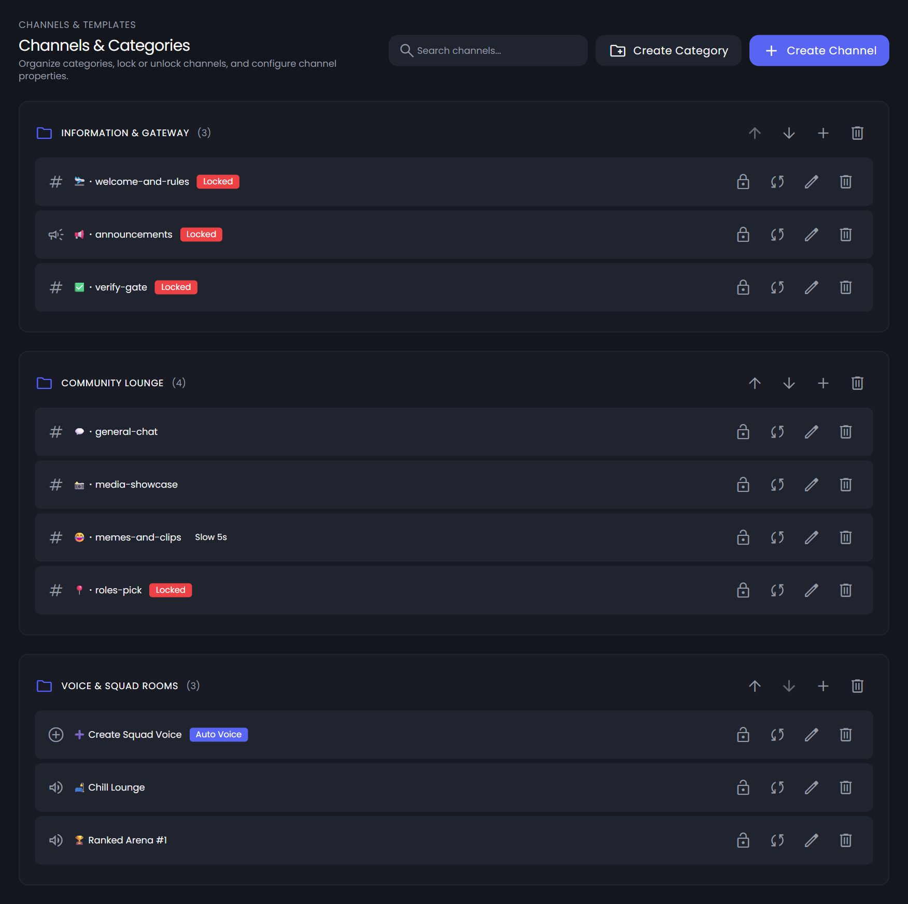
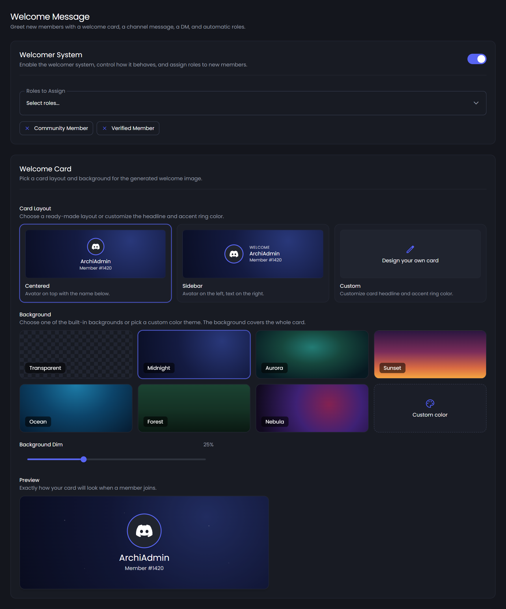
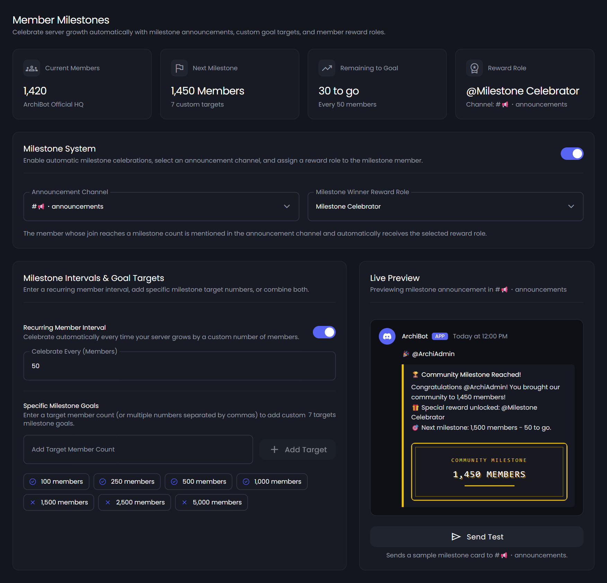

# ArchiBot — All-in-One Discord Server Architect & Web Studio

> Architect, deploy, and manage production-grade Discord communities through interactive slash commands and a full-stack **Material Design 3** web dashboard with real-time synchronization.

[](https://nodejs.org/)
[](https://discord.js.org/)
[](https://react.dev/)
[](https://expressjs.com/)
[](https://www.typescriptlang.org/)
[](LICENSE)

---

## Table of Contents

- [Overview](#-overview)
- [Core Capabilities](#-core-capabilities)
- [Web Dashboard Preview](#-web-dashboard-preview)
- [Architecture & Project Structure](#-architecture--project-structure)
- [Tech Stack](#-tech-stack)
- [Web Dashboard Modules](#-web-dashboard-modules)
- [Slash Commands Reference](#-slash-commands-reference)
- [Templates & Modular Lego Builder](#-templates--modular-lego-builder)
- [Getting Started (Local Development)](#-getting-started-local-development)
- [Environment Variables](#-environment-variables)
- [Production Deployment (Linux + PM2 + Caddy HTTPS)](#-production-deployment-linux--pm2--caddy-https)
- [Security & Permissions Hygiene](#-security--permissions-hygiene)
- [Verification & Testing](#-verification--testing)
- [License](#-license)

---

## Overview

**ArchiBot** eliminates hours of manual Discord server configuration by combining an interactive `discord.js` automation engine with a unified React web control plane. Administrators can scaffold entire community architectures—including categories, read-only rules, CAPTCHA verification gates, self-assignable role panels, support tickets, live stats voice counters, Join-to-Create voice hubs, giveaways, welcome banners, and member milestones—either directly inside Discord or through the browser dashboard over WebSockets.

All state, backups, giveaways, welcome/goodbye configurations, and per-guild settings persist cleanly on disk in `state.json`, while the Express 5 server hosts both the `/api/*` REST gateway, the `/ws` WebSocket event bus, and the compiled Vite frontend bundle (`dashboard/dist`) from a single Node.js process.

---

## Core Capabilities

- **1-Click Server Architect & Templates** — Provision complete layouts (`General Hangout`, `Community Hub`, `Gaming`, `Study & Projects`, or `Custom Layout`) in either `add` (non-destructive merge) or `replace` mode via `/setup` or the Web Template Builder.
- **12 Modular Lego Feature Blocks** — Mix and match independent feature packs (`News`, `Events & Giveaways`, `Chat Lounge`, `Member Galleries`, `Game Lounge`, `Minigames Bot`, `Study & Tech`, `Music Area`, and 4 dedicated Voice Hubs) with live channel previews before deployment.
- **Channel & Role Management Studio** — Visual drag-and-drop channel ordering, inline channel/category creation (`/create-channel`), and granular role hierarchy inspection directly from the web dashboard.
- **Dynamic Join-to-Create Voice Rooms** — Temporary voice channel generator (`/auto-voice`) paired with an interactive control panel (`/voice interface` & `/voice` subcommands) supporting Rename, User Limit, Lock/Unlock, Claim Ownership, Kick/Trust/Transfer, and Instant Delete.
- **Zero-Trust Image CAPTCHA Verification** — Self-contained image CAPTCHA challenge generator (`captcha.js`) with optional minimum account age enforcement (`min_account_hours`) and automatic Verified role assignment.
- **Welcome & Goodbye Studio** — Multi-part onboarding pipeline featuring generated welcome banner images, customizable channel embed cards, auto-role assignment, and Direct Message greetings, plus farewell notices.
- **Member Milestones Engine** — Automated recurring member-count celebration intervals and custom goal targets (`/milestone`), complete with custom milestone banner generation and reward role assignment.
- **Interactive Giveaways & Rich Embed Builder** — Schedule, host, reroll, and configure server giveaways alongside a live Discord-accurate Rich Embed composer.
- **Layout Backups & Snapshots** — Serialize entire server structures (channels, categories, permissions, voice hubs) to named snapshots (`/backup save|list|load|delete`) or JSON import/export in the dashboard.
- **Real-Time WebSocket Sync (`/ws`)** — Live channel, role, and member updates pushed from the Discord gateway directly to open dashboard sessions without manual reloads, alongside dark/light theme support and EN/ID landing localization.

---

## Web Dashboard Preview

<table>
  <tr>
    <td width="50%" align="center">
      <strong>Template Builder &amp; Modular Lego Blocks</strong><br/><br/>
      
    </td>
    <td width="50%" align="center">
      <strong>Channels, Roles &amp; Permissions Matrix</strong><br/><br/>
      
    </td>
  </tr>
  <tr>
    <td width="50%" align="center">
      <strong>Welcome Canvas &amp; Onboarding Studio</strong><br/><br/>
      
    </td>
    <td width="50%" align="center">
      <strong>Member Milestones &amp; Reward Tracker</strong><br/><br/>
      
    </td>
  </tr>
</table>

---

## Architecture & Project Structure

ArchiBot runs cleanly as a unified Node.js service (`server/index.js`) or split dev workflow (`server/dev.js` running Express alongside Vite HMR):

```text
ArchiBot/
├── bot.js                        # Core discord.js client, slash command registry, event handlers & automations
├── templates.js                  # 4 preset templates, 12 Lego modules, template parser & serializer
├── captcha.js                    # Zero-dependency PNG generator for CAPTCHA, welcome & milestone banners
├── voice-ui.js                   # Dynamic voice room control UI components & custom PNG icon renderer
├── state.json                    # Local persistent store for guild configs, backups, giveaways & stats
├── test.js                       # Repository integrity, style, gateway & state validation suite
├── .env.example                  # Environment variable template
│
├── server/
│   ├── index.js                  # Express 5 entry point, /api/* mounts, /api/health, /api/stats & static SPA
│   ├── dev.js                    # Development orchestrator launching server/index.js + Vite dev server
│   ├── botClient.js              # Shared discord.js client & state bridge between bot and REST API
│   ├── config.js                 # Environment & dynamic .env persistence helpers
│   ├── ws.js                     # WebSocket (/ws) server broadcasting live guild events to dashboard clients
│   ├── middleware/
│   │   └── auth.js               # HTTP-only JWT cookie verification & guild access guards
│   ├── routes/
│   │   ├── auth.js               # Discord OAuth2 (/login, /callback, /me, /logout, /setup-oauth, /dev-login)
│   │   ├── overview.js           # Guild summary, live metrics, audit snapshot
│   │   ├── channels.js           # Channel/category CRUD, permissions & reordering endpoints
│   │   ├── roles.js              # Role CRUD, color/permissions & member assignment endpoints
│   │   ├── members.js            # Member directory, search, moderation & role actions
│   │   ├── architect.js          # Template deployment, modular preview & clear/reset execution
│   │   ├── voice.js              # Join-to-Create hubs & active temp room management
│   │   ├── embeds.js             # Rich embed composer & panel dispatch endpoints
│   │   ├── backups.js            # Layout snapshot create/restore/export/import API
│   │   ├── settings.js           # Welcome, goodbye, milestones, bot profile & dashboard settings API
│   │   └── giveaways.js          # Giveaway lifecycle, winners, rerolls & configuration endpoints
│   └── data/                     # Runtime OAuth token & user guild cache (tokens.json, user_guilds.json)
│
└── dashboard/
    ├── index.html                # HTML shell with early dark/light theme initialization
    ├── vite.config.ts            # Vite dev proxy (/api & /ws -> 127.0.0.1:3000) + Tailwind v4 plugin
    ├── public/screenshots/       # Dark & light feature preview assets
    └── src/
        ├── App.tsx               # React Router routes & auth session loader
        ├── theme/theme.css       # Material Design 3 + Discord dark/light semantic tokens
        ├── hooks/useRealtime.ts  # Auto-reconnecting WebSocket subscription hook
        ├── components/           # Strict Atomic Design layers (atoms, molecules, organisms, templates, layout, features, ui)
        └── pages/                # Landing page, Server Selector & 15 per-guild studio pages
```

---

## Tech Stack

| Layer | Technologies |
|---|---|
| **Bot & Runtime** | Node.js `>= 20.12.0` (ESM, native `--env-file-if-exists`), `discord.js` `^14.18.0` |
| **Backend API & Realtime** | `express` `^5.3.0`, `ws` `^8.18.0`, `jsonwebtoken` `^9.0.3`, `cookie-parser`, `cors` |
| **Frontend UI** | `react` `^18.3.1`, `react-router-dom` `^6.28.0`, `typescript` `^5.6.3`, `vite` `^5.4.11` |
| **Design System & UX** | `@material/web` `^2.2.0` (Material Design 3), `tailwindcss` `^4.3.3`, `@dnd-kit/*`, `lenis` |

---

## Web Dashboard Modules

| Route | Page | Purpose |
|---|---|---|
| `/` & `/id` | Landing Page | Bilingual (EN/ID) product showcase, dark/light switcher, live preview & OAuth sign-in |
| `/blog`, `/blog/:slug` | Blog | Integrated changelog and documentation articles |
| `/servers` | Server Selector | Mutual guild switcher with quick bot invite links |
| `/guilds/:guildId` | Overview | Server health, member stats, quick actions & setup status |
| `/guilds/:guildId/analytics` | Analytics | Guild growth, activity breakdowns, verification & milestone summaries |
| `/guilds/:guildId/architect` | Template Builder | Deploy preset templates, toggle 12 Lego modules, add custom channels, or reset layout |
| `/guilds/:guildId/channels` | Channels | Visual category/channel manager with drag-and-drop & permissions |
| `/guilds/:guildId/roles` | Roles | Role hierarchy, colors, capabilities & permissions editor |
| `/guilds/:guildId/members` | Members | Member directory, role assignment, filtering & moderation tools |
| `/guilds/:guildId/welcome` | Welcome Studio | Configure welcome banner cards, channel embeds, auto-roles & welcome DMs |
| `/guilds/:guildId/goodbye` | Goodbye | Customize member departure messages & channel routing |
| `/guilds/:guildId/milestones` | Milestones | Recurring intervals, custom member targets, reward roles & banner preview |
| `/guilds/:guildId/giveaways` | Giveaways | Create, monitor, end, and reroll active server giveaways (`/giveaways/config` for defaults) |
| `/guilds/:guildId/voice` | Dynamic Voice | Configure Join-to-Create hubs & monitor active temporary rooms |
| `/guilds/:guildId/embeds` | Embed Builder | Compose and publish rich Discord embeds, verify panels & role/ticket panels |
| `/guilds/:guildId/backups` | Backups | Save, restore, import/export JSON channel layout snapshots |
| `/guilds/:guildId/audit` | Audit Logs | Inspect tracked administrative & bot actions |
| `/guilds/:guildId/settings` | Settings | Dashboard appearance, bot nickname/embed defaults & general guild settings |

---

## Slash Commands Reference

### Server Scaffolding & Channel Operations

| Command | Permission | Options / Subcommands | Description |
|---|---|---|---|
| `/setup` | Administrator | `template` (`general`, `community`, `games`, `study`, `custom`), `mode` (`add`, `replace`) | Scaffold a complete server layout from a preset or interactive Lego builder |
| `/create-channel` | Administrator | `name`, `type` (`text`, `readonly`, `voice`, `stage`, `category`), `category` | Instantly create styled channels or category dividers without opening Server Settings |
| `/clear-channels` | Administrator | `after` (`empty`, `keep`) | Delete all categories and channels, optionally retaining one fresh general channel |
| `/help` | Everyone | `language` | Display the interactive ArchiBot guide and command reference |

### Dynamic Voice Hubs & Room Controls

| Command | Permission | Options / Subcommands | Description |
|---|---|---|---|
| `/auto-voice` | Administrator | `name` (default: `Create Voice`), `category` | Create a dedicated Join-to-Create voice room generator hub |
| `/voice interface` | Staff / Admin | — | Post the persistent interactive Voice Room Controls button panel |
| `/voice lock` | Room Owner | — | Lock your temporary voice channel to prevent others from joining |
| `/voice unlock` | Room Owner | — | Re-open your temporary voice channel |
| `/voice limit` | Room Owner | `max_members` (`0`–`99`) | Set the member capacity limit for your voice room |
| `/voice rename` | Room Owner | `new_name` | Rename your temporary voice channel |
| `/voice claim` | Member in VC | — | Claim ownership of a temporary room if the original creator has left |
| `/voice delete` | Room Owner | — | Immediately close and delete your temporary voice room |

### Backups, Milestones & Community Panels

| Command | Permission | Options / Subcommands | Description |
|---|---|---|---|
| `/backup save` | Administrator | `name` | Save a snapshot of the server's current channel & category layout |
| `/backup list` | Administrator | — | List all saved layout backups for the current server |
| `/backup load` | Administrator | `name`, `mode` (`add`, `replace`) | Restore a saved layout alongside existing channels or from scratch |
| `/backup delete` | Administrator | `name` | Delete a saved layout snapshot |
| `/milestone set` | Administrator | `every`, `goals`, `channel`, `reward_role` | Configure recurring member intervals, target goals, announcement channel & reward role |
| `/milestone status` | Administrator | — | Check current member count, upcoming milestone goal & active settings |
| `/milestone test` | Administrator | — | Preview a sample generated milestone celebration banner in the channel |
| `/milestone disable` | Administrator | — | Disable automatic milestone announcements |
| `/verify-panel` | Administrator | `role`, `min_account_hours`, `title` | Post an interactive image CAPTCHA verification gate |
| `/role-panel` | Administrator | `roles`, `style`, `title` | Post a self-assignable role button/menu panel |
| `/ticket-panel` | Administrator | `title`, `message` | Post a private support ticket launcher panel |

---

## Templates & Modular Lego Builder

Running `/setup template: custom` (or opening **Template Builder** in the dashboard) provides **12 modular Lego packs** plus a **3-field custom channel modal**:

| Module ID | Module Name | Included Setup Highlights |
|---|---|---|
| `news` | News and Info | Read-only announcements, tournament info, partner servers, team finder |
| `events` | Events and Giveaways | Events schedule, giveaways channel, event chat, live stage podcast |
| `chat` | Chat Lounge and Memes | General chat, memes, bot commands |
| `galleries` | Member Galleries | Member gallery, pets, food & drinks, art & edits |
| `games` | Game Discussions | 10 channels (Valorant, CS, Dota 2, Minecraft, Roblox, Genshin, MLBB, Free Fire, PUBG, HoK) |
| `minigames` | Minigames Bot | Dedicated bot channels for OwO, Mudae, Karuta, Dank Memer, Poketwo |
| `study` | Study and Tech | Read-only study resources, general chat, homework help, code & tech, progress share |
| `music` | Music Area | Music discussion, Spotify & Jockie Music request channel, Lofi Radio voice room |
| `voice_casual` | Casual Voice | Voice settings & guide, `Create Casual` generator, Casual 1–3 |
| `voice_comp` | Competitive Voice | `Create Competitive` generator, Competitive 1–3 |
| `voice_hangout` | Hangout Voice | Voice settings & guide, `Create Voice` generator, Lounge 1–2, Movie Night, AFK |
| `voice_study` | Study Focus Voice | `Create Study Room` generator, Silent Study, Screen Share Study, AFK |

Preset templates (`general`, `community`, `games`, `study`) automatically assemble curated subsets of categories, channels, `@everyone` read-only permissions, auto-roles, and live stat voice counters.

---

## Getting Started (Local Development)

### 1. Prerequisites

- **Node.js v20.12+** (Node **22 LTS** recommended — required for `--env-file-if-exists`)
- **npm** v10+
- A Discord application created in the [Discord Developer Portal](https://discord.com/developers/applications)

### 2. Discord Developer Portal Configuration

1. Open your application in the **Discord Developer Portal** → **Bot** tab:
   - Copy the **Bot Token**.
   - Under **Privileged Gateway Intents**, enable **all three** intents used by ArchiBot:
     - `Presence Intent` (`GuildPresences`)
     - `Server Members Intent` (`GuildMembers`)
     - `Message Content Intent` (`MessageContent`)
2. Navigate to **OAuth2 → General**:
   - Copy your **Client ID** and **Client Secret**.
   - Under **Redirects**, add your local development callback URL:
     ```text
     http://localhost:5173/api/auth/callback
     ```
3. Under **OAuth2 → URL Generator**, select scopes `bot` and `applications.commands`, assign **Administrator** (or granular channel, role, member, message, and voice permissions), and invite the bot to your test server.

### 3. Installation

```bash
# Clone the repository
git clone https://github.com/Rafifdev/ArchiBot.git
cd ArchiBot

# Install backend & bot dependencies
npm install

# Install frontend dashboard dependencies
npm install --prefix dashboard
```

### 4. Configure `.env`

Copy `.env.example` to `.env` and fill in your credentials:

```bash
cp .env.example .env
```

### 5. Run the App

```bash
# Development mode: runs Express API + Discord Bot (port 3000) AND Vite HMR (port 5173)
npm run dev
```

Open **`http://localhost:5173`** in your browser. Vite proxies `/api/*` and `/ws` directly to `http://127.0.0.1:3000` (`dashboard/vite.config.ts`).

#### Available NPM Scripts

| Script | Command | Description |
|---|---|---|
| `npm run dev` | `node --watch --env-file-if-exists=.env server/dev.js` | Starts backend + bot with auto-reload alongside Vite frontend dev server (`:5173`) |
| `npm run build:dashboard` | `npm run build --prefix dashboard` | Type-checks (`tsc -b`) and builds the production SPA into `dashboard/dist` |
| `npm start` | `node --watch --env-file-if-exists=.env server/index.js` | Runs Express API, bot & serves `dashboard/dist` at `http://localhost:3000` |
| `npm run bot` | `node --env-file-if-exists=.env bot.js` | Runs the standalone Discord bot process only (no web dashboard server) |
| `npm test` | `node test.js` | Runs repository validation checks |

---

## Environment Variables

Defined in `server/config.js` and `.env.example`:

| Variable | Required | Default | Description |
|---|---|---|---|
| `DISCORD_TOKEN` | Yes | — | Discord bot token from Developer Portal → Bot |
| `DISCORD_CLIENT_ID` | Recommended | Auto-detected from logged-in bot | Discord OAuth2 Client ID |
| `DISCORD_CLIENT_SECRET` | Yes (for OAuth login) | — | Discord OAuth2 Client Secret |
| `DISCORD_REDIRECT_URI` | Yes | `http://localhost:5173/api/auth/callback` | Exact OAuth2 callback URL registered in Discord Developer Portal |
| `PORT` | No | `3000` | HTTP & WebSocket server listening port |
| `JWT_SECRET` | Yes (Production) | Built-in dev fallback | Strong random secret used to sign `archibot_token` session cookies |
| `FRONTEND_URL` | Yes (Production) | `http://localhost:5173` | Public origin of the dashboard for CORS and post-OAuth redirects |

> **Tip:** `DISCORD_CLIENT_SECRET`, `DISCORD_CLIENT_ID`, and `DISCORD_REDIRECT_URI` can also be updated dynamically at runtime via `POST /api/auth/setup-oauth`.

---

## Production Deployment (Linux + PM2 + Caddy HTTPS)

Because ArchiBot maintains a persistent Discord Gateway WebSocket connection, exposes `/ws` realtime updates, and persists data locally in `state.json`, it should be hosted on a persistent Node.js server/VM rather than stateless serverless functions.

### 1. Server Setup (Ubuntu 24.04 LTS)

```bash
# Install Node.js 22 LTS, Git, Caddy (automatic Let's Encrypt HTTPS), and PM2
sudo apt update && sudo apt install -y git curl debian-keyring debian-archive-keyring apt-transport-https
curl -fsSL https://deb.nodesource.com/setup_22.x | sudo -E bash -
sudo apt install -y nodejs caddy
sudo npm install -g pm2

# Clone repository and build frontend
git clone https://github.com/Rafifdev/ArchiBot.git
cd ArchiBot
npm install
npm install --prefix dashboard
npm run build:dashboard
```

*(If deploying to a 1 GiB RAM VM, configure a 2 GB swap file before running `npm run build:dashboard` to avoid out-of-memory errors during TypeScript/Vite bundling.)*

### 2. Production `.env`

```env
DISCORD_TOKEN=your_discord_bot_token
DISCORD_CLIENT_ID=your_discord_client_id
DISCORD_CLIENT_SECRET=your_discord_client_secret
DISCORD_REDIRECT_URI=https://your-domain.example/api/auth/callback

PORT=3000
JWT_SECRET=replace_with_strong_random_64_char_hex_secret
FRONTEND_URL=https://your-domain.example
```

Ensure ports `80` (HTTP) and `443` (HTTPS) are open in your cloud firewall / NSG, and register `https://your-domain.example/api/auth/callback` under **OAuth2 → Redirects** in the Discord Developer Portal.

### 3. Run 24/7 with PM2 & Caddy

```bash
# Start ArchiBot (Express + WebSocket + discord.js + built dashboard)
pm2 start server/index.js --name archibot --node-args="--env-file-if-exists=.env"
pm2 save
pm2 startup
```

Configure `/etc/caddy/Caddyfile` to reverse-proxy HTTPS traffic to port `3000` (including WebSocket `/ws` upgrades automatically):

```caddyfile
your-domain.example {
    reverse_proxy localhost:3000
}
```

```bash
sudo systemctl restart caddy
```

### 4. Updating a Live Deployment

```bash
cd ~/ArchiBot
git pull origin main
npm install
npm install --prefix dashboard
npm run build:dashboard
pm2 restart archibot
```

---

## Security & Permissions Hygiene

- **HTTP-Only JWT Session Cookies** — Signed sessions (`archibot_token`) use `httpOnly: true` and `sameSite: 'lax'` (`server/routes/auth.js`), preventing client-side JavaScript token access.
- **Role Safety Guards** — Dangerous elevated flags (`Administrator`, `ManageGuild`, `BanMembers`, etc.) are filtered out from self-assignable role panels so members cannot escalate privileges.
- **Zero-Trust Verification & Read-Only Channels** — Unverified accounts are prevented from posting in `@everyone` read-only channels (`announcements`, `rules`, guides) until passing the CAPTCHA gate.
- **Temporary Voice Room Isolation** — Dynamic voice rooms apply per-owner permission overwrites, isolating lock/kick/rename controls to the room creator (until explicitly transferred or claimed after departure).

---

## Verification & Testing

Run the dashboard TypeScript check + production bundle build alongside the repository test suite:

```bash
npm run build:dashboard && npm test
```

---

## License

This project is licensed under the [MIT License](LICENSE) — Copyright (c) 2026 Rafifdev.
